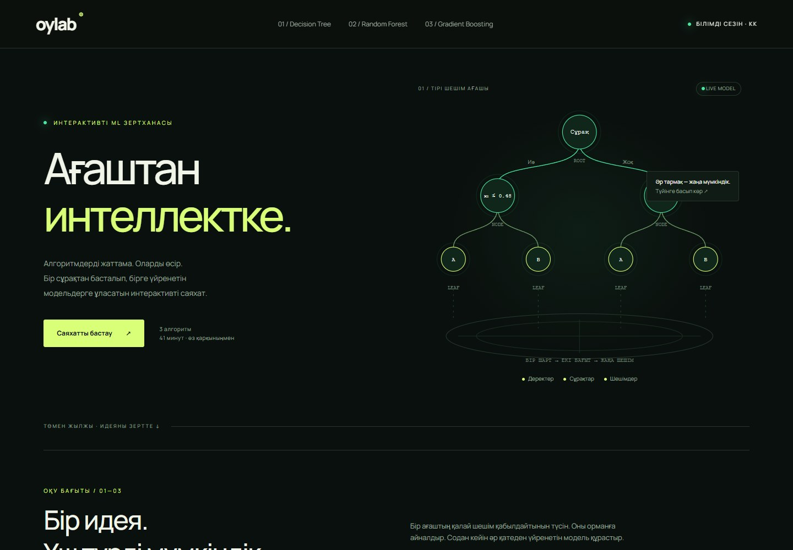
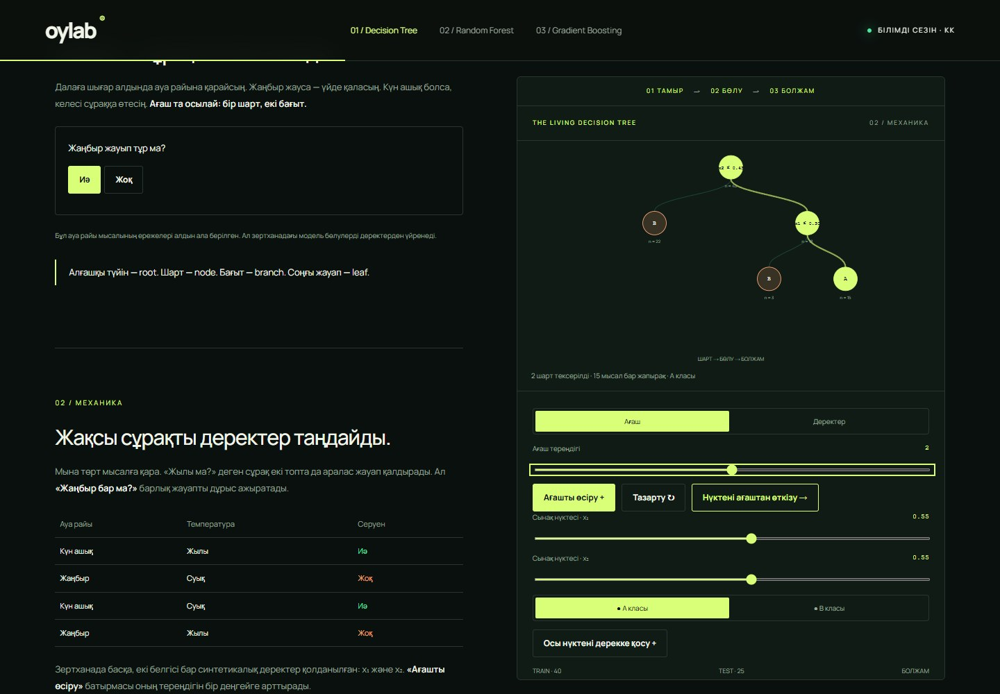
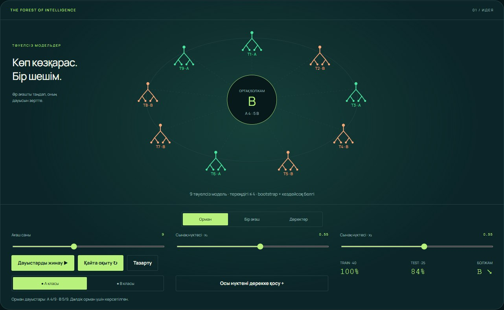
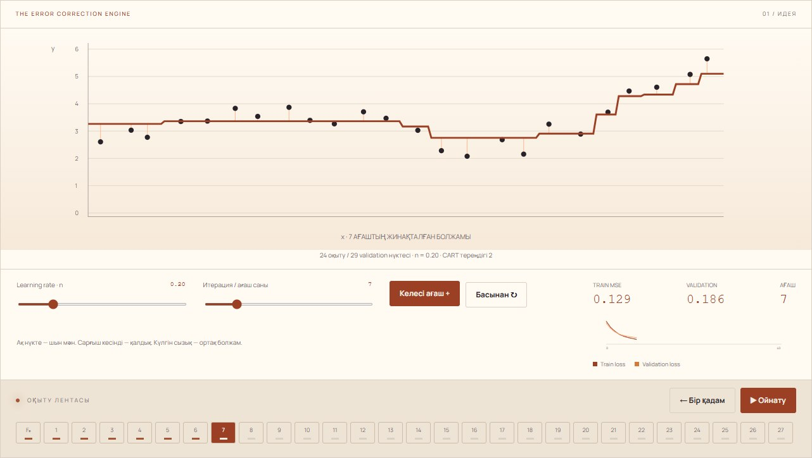
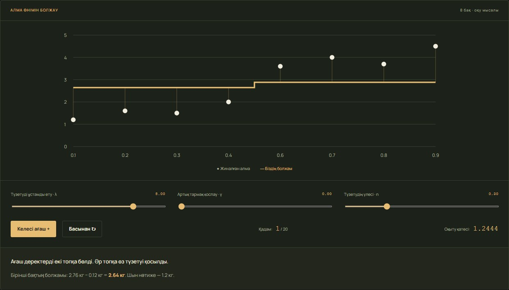
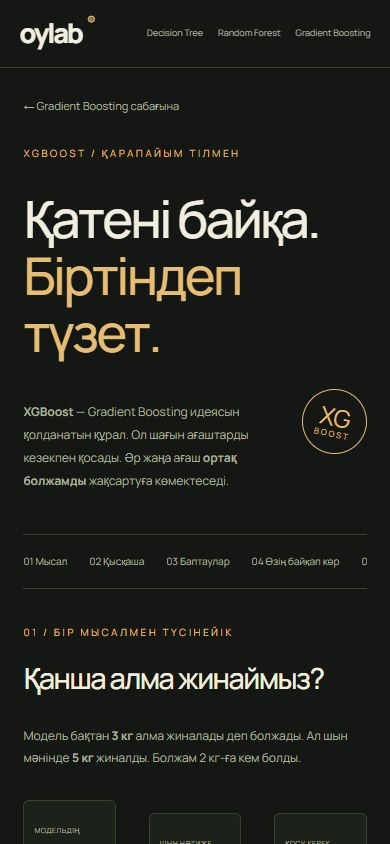

<div align="center">

<h1>OYLAB</h1>

<p><strong>Ағаштан интеллектке.</strong><br>От одного дерева — к моделям, которые учатся на своих ошибках.</p>

<p>Интерактивная лаборатория машинного обучения на казахском языке.<br>Читай объяснения, меняй параметры и наблюдай, как меняется результат.</p>

<a href="https://oylab-ml-journey.kiregami.chatgpt.site"></a>

<p><a href="https://oylab-ml-journey.kiregami.chatgpt.site">Публичная версия</a> · <a href="#уроки">Уроки</a> · <a href="#скриншоты">Скриншоты</a> · <a href="#запуск-локально">Запуск</a></p>

</div>

[](https://oylab-ml-journey.kiregami.chatgpt.site)

## Идея проекта

Понять алгоритм легче, когда можно проверить его самому. В OYLAB теория связана с живыми моделями: дерево растёт, лес объединяет голоса, а бустинг шаг за шагом уточняет прогноз.

Объяснения идут от бытового примера к эксперименту. На страницах Random Forest и Gradient Boosting сначала расположен весь учебный материал, затем лаборатория: графики не перекрывают текст при прокрутке. У XGBoost есть простой пример с урожаем яблок, а формулы можно раскрыть по желанию.

## Уроки

| Урок | Что можно попробовать |
| --- | --- |
| [**01 · Decision Tree**](https://oylab-ml-journey.kiregami.chatgpt.site/decision-tree/) | Вырастить дерево, провести точку по ветвям, изменить глубину и разобраться в Gini. |
| [**02 · Random Forest**](https://oylab-ml-journey.kiregami.chatgpt.site/random-forest/) | Посмотреть bootstrap-выборки, изменить число деревьев и собрать их голоса в общий ответ. |
| [**03 · Gradient Boosting**](https://oylab-ml-journey.kiregami.chatgpt.site/gradient-boosting/) | Добавлять деревья-корректоры, менять learning rate, сравнивать ошибки на обучающих и проверочных данных. |
| [**04 · XGBoost**](https://oylab-ml-journey.kiregami.chatgpt.site/xgboost/) | На примере урожая понять постепенные поправки, сравнить готовые настройки и увидеть, когда лишняя ветка не нужна. |

В уроках есть вопросы для самопроверки. Страница XGBoost открывается также через отдельный блок внутри Gradient Boosting.

## Скриншоты

Скриншоты сделаны с опубликованного сайта. На них показаны работающие учебные модели.

| Decision Tree | Random Forest |
| :---: | :---: |
|  |  |
| Один вопрос → две ветви → решение | Разные модели → голоса → общий ответ |

| Gradient Boosting | XGBoost |
| :---: | :---: |
|  |  |
| Каждый шаг уточняет общий прогноз | Поправки с контролем сложности |

<details>
<summary><strong>Посмотреть мобильную версию</strong></summary>

<p align="center"></p>

Интерфейс адаптируется к небольшому экрану. Кнопки и ползунки доступны с клавиатуры; анимация учитывает настройку уменьшения движения.

</details>

## Мультивселенная как дерево событий

Один момент может вести к разным историям. В уроке Decision Tree эта идея показана через образ дерева времени из «Локи»: пользователь делает два выбора и приходит к одному из четырёх исходов.

<p align="center"></p>

*Loki, сезон 2 (2023), © Marvel Studios. Скриншот предоставлен пользователем.*

[**Попробовать дерево событий ↗**](https://oylab-ml-journey.kiregami.chatgpt.site/decision-tree/#multiverse)

Это заранее заданная учебная история. Она помогает понять корень, ветви и листья. Обучаемое дерево решений использует похожую структуру, но выбирает условия разделения по данным.

## Что происходит под капотом

Вычисления выполняются в браузере на небольших синтетических наборах данных:

- **Decision Tree:** бинарные разделения по Gini, ограничение глубины и предсказание класса.
- **Random Forest:** bootstrap-выборка для каждого дерева, случайный выбор одного признака при разделении, итоговое голосование. При равенстве голосов выбирается класс A.
- **Gradient Boosting:** регрессионные деревья глубины 2 обучаются на остатках; их поправки добавляются к общему прогнозу.
- **Пример XGBoost:** деревья глубины 1 с градиентами, вторыми производными, L2-регуляризацией и оценкой Gain. Это учебная реализация основных формул, а не подключённая библиотека XGBoost.

Для оценки используются отдельные тестовые или validation-данные там, где это предусмотрено уроком. Лаборатория XGBoost показывает ошибку на своих восьми обучающих примерах. Хороший результат на этих примерах сам по себе не доказывает качество на новых данных.

Настройки первых трёх лабораторий и добавленные точки классификации сохраняются в `localStorage` браузера.

## Запуск локально

Для запуска нужен **Python 3**. Сборка и установка npm-пакетов не требуются.

```bash
git clone https://github.com/arcnosixta/oylab.git
cd oylab
python -m http.server 8080 --directory dist
```

Открой [localhost:8080](http://localhost:8080).

Если установлен Node.js, тот же сервер можно запустить командой `npm start`; Python всё равно нужен. Для шрифта используется Google Fonts, поэтому без интернета браузер подставит запасной шрифт.

## Проверка расчётов

Нужны **Node.js и npm**. Внешние зависимости устанавливать не нужно.

```bash
npm test
```

Тесты проверяют Gini, разделения и глубину дерева, bootstrap, воспроизводимость, голосование, обучение на остатках, расчёт MSE, веса листьев, регуляризацию и отклонение невыгодного разделения.

## Структура

```text
oylab/
├── dist/                       # Готовый статический сайт
│   ├── index.html              # Главная страница
│   ├── decision-tree/          # Урок 01
│   ├── random-forest/          # Урок 02
│   ├── gradient-boosting/      # Урок 03
│   ├── xgboost/                # Дополнительный урок
│   ├── assets/                # Изображение мультивселенной
│   ├── app.js                 # Навигация и основные интерактивы
│   ├── models.js              # Дерево, лес и градиентный бустинг
│   ├── lessons.js             # Учебные тексты и вопросы
│   ├── xgboost-lesson.js       # Простое объяснение XGBoost
│   ├── xgboost-model.js        # Расчёты учебной модели
│   └── *.css                  # Оформление и адаптивная вёрстка
├── docs/images/               # Скриншоты для README
├── tests.mjs                  # Проверки основных алгоритмов
├── xgboost-model.test.mjs      # Проверки регуляризованного бустинга
└── package.json               # Команды запуска и тестирования
```

Стек: **HTML · CSS · JavaScript ES modules · SVG**. Приложение статическое, без серверной части и зависимостей времени выполнения. При правках общей HTML-оболочки обновляй также `index.html` в каталогах уроков; у XGBoost сохраняй собственный заголовок страницы.

## Материалы и источники

- Предоставленная презентация 9-й лекции — основа объяснений Decision Tree. Разделы об ансамблях дополнены отдельно.
- [scikit-learn: ансамбли и градиентный бустинг](https://scikit-learn.org/stable/modules/ensemble.html).
- [XGBoost: деревья, целевая функция и регуляризация](https://xgboost.readthedocs.io/en/stable/tutorials/model.html).
- [Framestore: визуальная идея дерева времени в Loki](https://www.framestore.com/work/loki-season-2).

---

<p align="center"><strong>Сначала понять. Потом изменить. Потом увидеть результат.</strong><br><a href="https://oylab-ml-journey.kiregami.chatgpt.site">Открыть OYLAB ↗</a></p>
